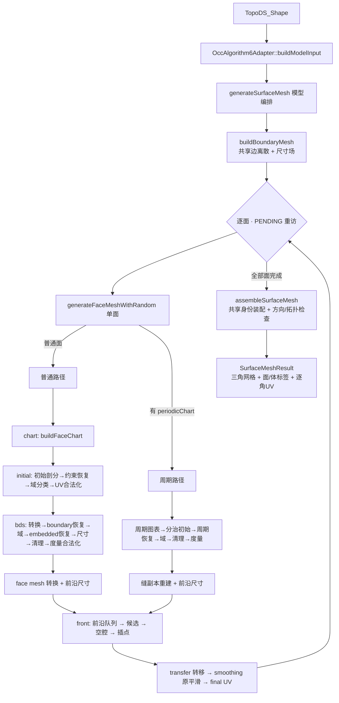

# Algorithm 6 阅读路线与面试要点（从 SurfaceGenerator 出发）

> 面向：面试前两天，要从 `SurfaceGenerator` 把整条算法读通、并能讲清楚的人。
> 所有路径、函数名、行号都对着 `F:\Code\MeshStudio` 当前代码，不是泛泛而谈。
> 配套文档（已存在，建议交叉读）：
> - `docs/superpowers/specs/2026-10-07-gmsh-surface-reproduction-modules-design.md` —— 模块职责权威表
> - `docs/superpowers/plans/2026-10-08-algorithm6-main-flow-review-plan.md` —— 主流程与验收门槛
> - `docs/superpowers/plans/2026-10-09-algorithm6-final-acceptance-results.md` —— 现状与失败项
> - `docs/gmsh-表面三角化源码导读.md` —— 与 Gmsh 源码的逐项对照

---

## 0. 先分清：你从 `SurfaceGenerator` 读的是哪条链

项目里**有两条表面三角化链**，产物都叫"三角形"，但来历完全不同。**分不清这一点，后面全乱。**

| | **legacy 路径**（产品默认） | **Algorithm 6 路径**（你要读的） |
|---|---|---|
| 入口 | `mesher::generateCadSurfaceMesh` | `mesher::gmshReference::generateSurfaceMesh` |
| 主编排 | `src/mesh/surface/legacy/CadSurfaceMesher.cpp`（2600+ 行） | `src/mesh/surface/algorithm6/pipeline/SurfaceGenerator.cpp`（488 行） |
| 目录 | `src/mesh/surface/legacy/` | `src/mesh/surface/algorithm6/` |
| 路线 | 自研「参数域 CDT + 三维判据自适应细化」 | **忠实复刻 Gmsh 4.15.2 的 Algorithm 6（Frontal-Delaunay）** |
| 教程 | 《初学者理解路线》《OCC-BRep到三角面片-完整流程》《算法原理与踩坑总结》 | 本文 |

> ⚠️ 现有三份中文教程**全部讲的是 legacy 路径**。它们讲的 `CadSurfaceMesher.cpp`、
> `Constrained2D.cpp`、`Delaunay2D.cpp` **不在** Algorithm 6 链上。
> 你从 `SurfaceGenerator` 出发，读的是**复刻 Gmsh 的那条**。

**一句话定位**：Algorithm 6 链 = 用 OCC 当几何查询器，把 Gmsh 的 Algorithm 6 用纯 C++
**按阶段、按模块重新实现一遍**，目标是能在同 CAD、同参数下和 Gmsh **逐阶段对照**。
它**不链接 Gmsh**（Gmsh 只存在于测试里的独立对照进程）。

**为什么在本项目中自行实现**：目标是掌握共享棱节点身份、CAD 标签、逐角 UV 和各阶段网格状态的数据流，让生成核心不依赖 Gmsh，并能通过独立对照定位差异。这里描述的是本项目的实现目标，不能据此推断 Gmsh 无法提供这些能力；跨面、多区域公共剖分也不因复刻完成就自动具备。

---

## 1. 一张图看懂主链



**两层调度**（面试常被追问）：
- **内层**（`generateFaceMeshWithRandom`）：一个面内部 8~13 个 stage 顺序推进。
- **外层**（`generateSurfaceMesh`）：模型级 `PENDING` 遍历 + 共享边重试。
  某个面恢复失败 → 把失败的**共享边**交回 → `refineUnrecoveredEdges` 加密 → **只失效关联面** → 重访。
  上限是 `options.maximumRecoveryRetries`（默认 10），对应 Gmsh 的 `meshGFace` 局部重试 + `Generator` 串行重访。

---

## 2. 分 6 层读（每层给文件 + 函数 + "看懂什么"）

### 第 0 层 · 边界与契约（半天）

先读**数据类型**，不读算法。它们是所有阶段的"接口语言"。

| 文件 | 看什么 |
|---|---|
| `algorithm6/data/SurfaceTypes.h` | `MeshingStatus`（7 态）、`OperationStatus`、`OperationFailure`、`SurfaceMeshingOptions`、`RunControl`、`NodeSize` |
| `algorithm6/data/FaceMeshTypes.h` | `FaceVertex`（id/physicalId/origin/dimension/parameters/storedSize）、`FaceMesh` |
| `algorithm6/data/BdsTypes.h` + `BdsTopology.h` | `BdsPoint` / `BdsEdge` / `BdsTriangle` / `BdsMesh` |
| `algorithm6/data/FrontMeshTypes.h` | `FrontTriangle`（vertices/meanSizes/radius/neighbors/deleted）、`FrontMesh` |

**看懂什么**
- 状态是**显式返回值**，不是异常裸奔：`OperationFailure` 只用来跨模块提前退出。
- `RunControl` 三件套：`keepGoing()`（取消）、`maximumGeometryEvaluations`（查询预算）、`maximumNodes`（节点预算）。
- `NodeSize` 有两个**不许合并**的长度：`meshSize`（面内插值用）和 `backgroundSize`（独立求值用）。

### 第 1 层 · 顶层编排（半天）★ 从这里开始

| 文件 | 函数 |
|---|---|
| `pipeline/SurfaceGenerator.h` | `generateFaceMesh` / `generateSurfaceMesh` 的接口注释 |
| `pipeline/SurfaceGenerator.cpp` | `generateSurfaceMesh`（模型级）、`generateFaceMeshWithRandom`（单面普通）、`finalizeFaceMeshCoordinates` |
| `pipeline/PeriodicSurfaceGeneration.cpp` | `generatePeriodicFaceMesh`（单面周期） |
| `pipeline/MeshAssembly.cpp` | `assembleSurfaceMesh` |
| `cad/occ/OccAlgorithm6Adapter.h/.cpp` | `buildModelInput` / `buildFaceInput`（CAD → 算法输入） |

**看懂什么**
- 单面普通路径的 **stage 顺序**（代码里 `stage("...")` 就是阶段名，直接对着读）：
  `chart → initial → bds_conversion → boundary_recovery → bds_domain → bds_sizes → initial_legalization → front_sizes → front → transfer → smoothing → final_coordinates`
- 预算怎么累加：`spend(n)` 累加到 `result.statistics.geometryEvaluations`，超了就抛 `BudgetExceeded`；
  `limits()` 每次都把剩余预算传给下一阶段。
- 失败怎么传播：`require(status)` / `throw OperationFailure` → 被最外层 `catch` 收成 `result.status`。
  **失败不发布 mesh**（`result.mesh` 只在成功路径末尾赋值）。

### 第 2 层 · 边界 + 图表（半天）

| 文件 | 函数 | 对应 Gmsh |
|---|---|---|
| `boundary/MeshSizeEvaluator.cpp` | `evaluateMeshSize` / `evaluateCurvatureSize` | `BackgroundMeshTools.cpp` |
| `boundary/CurveDiscretization.cpp` | `integrateCurveDensity` → `smoothCurveSizes` → `computeCurvePointCount` → `distributeCurveParameters` → `filterCurveNodes` | `meshGEdge.cpp` |
| `boundary/BoundaryRegistry.cpp` | `buildBoundaryMesh` / `refineUnrecoveredEdges` / `findIncidentFaces` | `meshGVertex/meshGEdge` |
| `chart/FaceChart.cpp` | `buildFaceChart` | `meshGFace.cpp::meshGenerator` |
| `chart/PeriodicFaceChart.cpp` | `buildPeriodicFaceChart` / `sampleTrueBoundary` / `assemblePeriodicBoundaryLoop` | 周期分支 |
| `chart/ParametricDomain.cpp` | `testParametricDomain` / `computeParametricFarPoint` | 真参数域门控 |

**看懂什么**
- **边界采样的核心思想**：每条 CAD 边只有**一份**离散节点链（`BoundaryCurve.samples`），
  相邻面共享它 → 从根上保证不裂缝。这是与 OCC 内置三角化（逐面各算各的）最本质的区别。
- 采样怎么定：曲线速度积分 `∫|C'(t)|/h(t) dt` → 反解参数 → 过滤过近点。
- **图表（chart）**：把 CAD 边界身份翻译成面内 UV + 约束 + 初始插入顺序。
  `FaceChartRoute` 有 4 个出口：`SkipInsufficientNodes`（<3 点早退）、`DirectTriangle`（正好 3 点）、
  `General`（正常）、`PeriodicRequired`（有 seam，交给周期路径）。

### 第 3 层 · 初始网格（1 天）★ 最绕的一段

**普通路径**（PolyMesh → BDS 两轮）：

```
buildInitialTriangulation        扩盒 + Walk 初始剖分（纯 UV 半边池）
  → prepareInitialConstraints    约束身份转换（localId → 物理ID → 池索引）
  → recoverConstraintEdges       约束恢复（FIFO 翻边）
  → classifyFaceDomain           域分类（外域 -2 / 内域 faceTag）
  → legalizeInitialUvMesh        raw UV 翻边（最多 100 轮扫描）
  ───────────────────────────── 换数据结构 ─────────────────────────────
  → convertOrdinaryInitialMeshToBds   PolyMesh → BDS
  → buildOrdinaryBdsRecoveryRegistry  登记约束
  → recoverOrdinaryBdsBoundary        BDS 再恢复一次 boundary（不同求交判据！）
  → classifyOrdinaryBdsDomain         BDS 域标记（LIFO）
  → recoverOrdinaryBdsEmbedded        域后 embedded 恢复
  → initializeOrdinaryBdsNodeSizes    BDS 节点 BGM 双尺寸
  → prepareOrdinaryBdsInterior        删空域面/孤边 + 两次非稳定 cleanup
  → legalizeInitialMesh               BDS 度量合法化（动态池扫描 + 配置去重）
  → initializeFaceMeshVertices + convertBdsToFaceMesh   BDS → FaceMesh
```

| 文件 | 关键函数 |
|---|---|
| `initial/InitialTriangulation.cpp` | `buildInitialTriangulation` / `buildPeriodicInitialTriangulation` |
| `initial/WalkTriangulation.cpp` | `buildWalkTriangulation` |
| `initial/ConstraintRecovery.cpp` | `prepareInitialConstraints` / `recoverConstraintEdges` / `intersectRecoverySegments` |
| `initial/DomainClassification.cpp` | `classifyFaceDomain` |
| `initial/InitialUvLegalization.cpp` | `legalizeInitialUvMesh` |
| `initial/DivideAndConquerTriangulation.cpp` | `buildDivideAndConquerTriangulation`（周期专用） |
| `data/HalfEdgeTopology.cpp` | `swapHalfEdgeDiagonal` / `rewriteHalfEdgeTriangle` |
| `bds/BdsMeshConversion.cpp` | `convertOrdinaryInitialMeshToBds` / `convertPeriodicInitialMeshToBds` |
| `bds/BdsCurveRecovery.cpp` | `buildOrdinaryBdsRecoveryRegistry` / `recoverOrdinaryBdsBoundary` / `recoverOrdinaryBdsEmbedded` |
| `bds/BdsConstraintRecovery.cpp` | `recoverBdsConstraintEdge` / `intersectBdsRecoverySegments` / `canSwapBdsRecoveryEdge` |
| `bds/BdsDomainClassification.cpp` | `classifyOrdinaryBdsDomain` / `classifyPeriodicBdsDomain` |
| `bds/BdsNodeSizeInitialization.cpp` | `initializeOrdinaryBdsNodeSizes` |
| `bds/BdsInteriorPreparation.cpp` | `prepareOrdinaryBdsInterior` / `prepareBdsInterior` |
| `bds/BdsSwapQualification.cpp` | `canSwapInitialBdsEdge` / `computeBdsParameterTriangleArea` |
| `bds/InitialMeshLegalization.cpp` | `legalizeInitialMesh` / `shouldFlipInitialEdge` |
| `bds/PeriodicBdsRecovery.cpp` | `recoverPeriodicBdsConstraints` |
| `postprocess/FaceMeshConversion.cpp` | `initializeFaceMeshVertices` / `convertBdsToFaceMesh` |
| `postprocess/PeriodicSeamReconstruction.cpp` | `reconstructPeriodicSeamVertices` |

**看懂什么（面试重点）**
- **为什么要 PolyMesh 恢复一次、BDS 又恢复一次？**
  忠实复刻 Gmsh：PolyMesh 用**严格面积乘积**判相交，BDS 用**sys2x2 解参数 + 闭区间**判相交，
  两套判据不同，得到的中间拓扑也不同。不能合并成一轮。
- **为什么要两套数据结构？** `WalkTriangulation` 是半边池（PolyMesh 语义），
  `BdsMesh` 是"节点/边/面三池 + 双向邻接"（BDS 语义）。Gmsh 算法 6 的初始段确实在两者之间转换。
- **域分类不能只看重心**：要沿邻接 BFS/LIFO 传播，跨外环/孔翻转奇偶。
- **度量合法化 ≠ UV 合法化**：`legalizeInitialUvMesh` 用**裸 UV 的 incircle**；
  `legalizeInitialMesh` 用**边中点处的曲面度量圆**。顺序不能换。
- **周期缝**：进入前沿前必须把"重复物理身份"拆成**临时副本**（`reconstructPeriodicSeamVertices`），
  记录 `equivalence`（副本→原节点）和每个副本的 UV，**不能在进前沿前折叠**。

### 第 4 层 · 前沿生成（1 天）★ 算法 6 的灵魂

| 文件 | 函数 |
|---|---|
| `front/NodeSizeInitialization.cpp` | `initializeNodeSizes`（物理邻边最短长度 → 双尺寸） |
| `front/FrontTriangleInitialization.cpp` | `initializeFrontTriangles`（算物理 R/h、建邻接） |
| `front/FrontTriangleOrdering.cpp` | `makeFrontTriangleKey` / `FrontTriangleKeyLess`（R 降序 + 节点身份决胜） |
| `front/FrontQueue.cpp` | `initializeFrontQueue` / `popActiveTriangle` / `registerFrontTriangles` / `updateActiveTriangles` / `markInsertionFailure` |
| `front/FrontGeneration.cpp` | `generateFrontMesh`（主循环） |
| `front/FrontPointPlacement.cpp` | `computeFrontPoint` / `correctFrontPointOnSurface` |
| `front/FrontPointLocation.cpp` | `findContainingFrontTriangle` / `mapFrontPointToTriangle` / `interpolateNodeMeshSize` |
| `front/FrontCavity.cpp` | `buildFrontCavity` / `rollbackFrontCavity` |
| `front/FrontInsertion.cpp` | `insertFrontPoint` / `validateFrontInsertion` / `commitFrontInsertion` / `insertFrontTriangles` |
| `geometry/SurfaceMetric.cpp` | `evaluateSurfaceMetric` / `computeMetricCircumcircle` / `computePhysicalCircumradius` |
| `geometry/CurveSurfaceIntersection.cpp` | `intersectCircleWithSurface` / `solveCurveSurfaceIntersection` |

**主循环（`generateFrontMesh`，78 行，务必逐行读）**

```
while (活动队列非空) {
    popActiveTriangle          取一个活动片（R 最大的）
    computeFrontPoint          在活动边上算"近等边"候选（度量外心）
    correctFrontPointOnSurface 用物理圆 / 曲面求交修正到曲面上
    [可选] testParametricDomain  周期真边界门控（普通面不走）
    insertFrontPoint           定位 → 空腔 → 验收 → 提交 → 队列局部更新
}
```

**看懂什么（面试重点）**
- **R/h 调度**：`radius = 物理外接圆 R / targetSize`，队列按 R **降序**（`FrontTriangleKeyLess`），
  优先处理"最坏"的片。`frontalRadiusLimit() = 0.5·√2`。
- **候选怎么来**：先在 UV 重心处查度量 → 构造**度量外心** → `L = min(h·√3/2, 度量外心距离)`。
  这是 Frontal 的"近等边"目标，不是简单外心。
- **空腔插点**：`buildFrontCavity` 找"外接圆包含新点"的片集合 + DFS 壳边，
  内部边按**精确节点身份**保护（不折叠缝）。
- **验收才是关键**：`validateFrontInsertion` 检查单片/Euler/UV 面积/距离/角度（原生返回码 1/-1/-2/-3/-4/-5）。
  **正常拒绝 ≠ 错误**：拒绝是预期行为，要保留已 append 的参数/尺寸槽，只销毁 live 节点。
- **失败半径**：`markInsertionFailure` 把 R 置 0/-1 重排，对应 Gmsh 的 worst 半径转换。

### 第 5 层 · 后处理与装配（半天）

| 文件 | 函数 |
|---|---|
| `postprocess/FrontMeshTransfer.cpp` | `transferFrontMesh`（运行池 → 面连接，统一朝向，单次等价映射） |
| `postprocess/SurfaceSmoothing.cpp` | `smoothSurfaceMesh` / `computeSmoothedPosition` / `acceptSmoothedPosition` |
| `geometry/MeshVertexParameters.cpp` | `reparameterizeMeshVertexOnFace` / `reparameterizeMeshEdgeOnFace` |
| `pipeline/MeshAssembly.cpp` | `assembleSurfaceMesh` |

**看懂什么**
- **转移**：按运行 `AllTris` 顺序替换面连接；以**首活片的原 double 法线**统一朝向；
  有 `equivalence` 时先诊断重复，再单次映射并丢弃身份退化片。**转移不释放运行池、不平滑**。
- **平滑**：只移动 `dimension==2` 且 `entity==mesh.entity` 的自由内点；
  度量加权位置 + **临时** UV 面积/最差 eta 验收；每节点**固定五次试探**（即使接受也继续缩步）；
  成功后还要再查一次 GPoint 才发布。边界/embedded/极点不动。
- **装配**：共享 0D/1D 按 `(body, physicalId)` 合并，2D 按 `(body, face, id)`；
  **不按坐标焊接**；检查重复片、零面积片、整模型边关联（每边恰好两个反向面）和 CAD 边界段完整性。

---

## 3. 三个核心数据结构（必须能画出来）

### `FaceMesh`（前沿前的面网格）
- `vertices: map<id, FaceVertex>`：`id` 是**本阶段身份**（不复刻进程全局编号），`physicalId` 是 CAD 物理身份。
- `equivalence: map<副本, 原节点>`：周期缝副本映射，**此阶段不折叠**。
- `triangleCornerUV`：周期折叠前的**每角 UV**；空表示普通节点参数视图。

### `BdsMesh`（BDS 三池）
- `points: map<int, BdsPoint>`：**保留负 ID 和空洞**（外围点是 -1..-4）。
- `edges: vector<BdsEdge>` / `triangles: vector<BdsTriangle>`：**稳定池索引**，删除只标记不搬家。
- `BdsClassification`：`(tag, dimension, origin)`；`origin` 区分"注册对象"和"临时域标记"。
- 双向邻接：`BdsPoint.edges`、`BdsEdge.faces`、`BdsTriangle.edges`。

### `FrontMesh` + `FrontQueueState`（前沿运行态）
- `FrontMesh.triangles`：**创建序稳定池**，`deleted` 标记，`neighbors[3]` 邻接。
- `orderedTriangles`：初始 `AllTris` **快照**，之后不再改。
- `FrontQueueState.allTriangles / activeTriangles`：运行期**两个 set**，键是 `(radius, 排序顶点身份)`。
- 关键不变量：**键不可变**——要改半径必须先 `extract` 再 `insert`，否则 set 序被破坏。

---

## 4. 反复出现的 8 个设计取舍（面试高频）

| # | 取舍 | 为什么这么做 |
|---|---|---|
| 1 | **每阶段"成功才原子替换 output"** | 失败不发布半个网格；调用方拿到的一定是完整或未动。 |
| 2 | **状态显式返回，异常只做提前退出** | 取消/预算不能被 `catch(...)` 吞成"未知几何错误"。 |
| 3 | **几何查询全部走显式回调** | 纯 `mesher` 库不链接 OCC/Qt/VTK/Gmsh；CAD 适配在 `src/cad/`。 |
| 4 | **身份（identity）与坐标（XYZ）分离** | 不按坐标焊接/合并；共享靠 `physicalId`，不靠浮点相等。 |
| 5 | **两套约束恢复判据并存** | 复刻 Gmsh：PolyMesh 严格面积乘积 vs BDS sys2x2 闭区间。 |
| 6 | **两个尺寸状态不合并** | `meshSize`（面内插值）与 `backgroundSize`（独立求值）语义不同。 |
| 7 | **生成成功 ≠ 质量验收** | `Algorithm6SurfaceResult.status` 与独立质量审计分开报告。 |
| 8 | **诊断开关默认关、不改算法行为** | 全网格自检放进热循环会把 O(n·T_avg) 退化成 O(n·T)（`ball.brep` 0.82s→135s+）。 |

---

## 5. 现状与已知短板（**面试要诚实讲，反而加分**）

来源：`docs/superpowers/plans/2026-10-09-algorithm6-final-acceptance-results.md`（2026-10-09）。

- **相对验收通过**：34 组形状/拓扑相对门槛全过；31 个绝对审计合格配置的 **93 轮性能全过**，
  最慢中位耗时比 **1.636623**（门槛是 ≤ Gmsh 的 2 倍）。
- **真实窗口验证**：球面 200 点 396 片；手机 29980 点 59612 片，生成/取消/导出/重开都过。
- **保留的失败（不掩盖）**：
  - **手机两组 + 凹球点尺寸传播 1** 共 **3 个共有绝对失败**（自研和 Gmsh 都不通过，未修）。
  - 手机常量配置 **11 对错误相交**——但与官方 Gmsh **完全一致**（是模型/CAD 层面的共同问题）。
- **边界**：
  - 只覆盖**各向同性、串行、一阶三角**；**不含**并行、体网格、高阶、跨光滑面 compound。
  - Gmsh 失败时的 **MeshAdapt 自动切换显式关闭**（`switchOnFailure=false`），不拿另一个算法的结果冒充算法 6。
  - **无用户指定的绝对 CAD 距离容限**，所以只报"双向实测距离"，不宣称绝对精度达标。
- **生产默认仍是 legacy**；Algorithm 6 是显式实验入口。

> **面试话术**：不要说"做完了、很完美"。要说
> "相对 Gmsh 在 34 组配置上质量/拓扑/性能都达标，但保留了 3 个双方共有的绝对失败，
> 因为那不是算法实现问题，是 CAD 模型/几何本身的问题；我没有放宽门槛去掩盖它们。"

---

## 6. 两天计划（每天 3~4 小时）

### Day 1：读通 + 能画图

| 时段 | 做什么 | 产出 |
|---|---|---|
| 1h | 第 0 层数据契约 + 第 1 层 `SurfaceGenerator.cpp` 通读 | 手画一遍 12 个 stage 的顺序 |
| 1h | 第 2 层：边界采样 + `buildFaceChart` | 能说清"为什么每条棱只有一份节点" |
| 1.5h | 第 3 层：初始网格（普通路径 13 步） | 画 PolyMesh→BDS 的转换点，标出两轮恢复 |
| 1h | 第 4 层主循环 `generateFrontMesh` + 候选/空腔 | 手写伪代码，标出 R/h 调度 |

### Day 2：讲通 + 抗追问

| 时段 | 做什么 | 产出 |
|---|---|---|
| 1h | 第 5 层：转移/平滑/装配 + 周期缝生命周期 | 能讲清 `equivalence` 什么时候折叠 |
| 1h | 跑测试（见 §8），打开诊断开关看一次真实输出 | 截一张阶段输出 |
| 1h | 背 §4 的 8 个取舍 + §7 自测题 | 每题 30 秒内能答 |
| 1h | 自己对着白板讲一遍全流程（录音回听） | 找出卡壳点，回去补 |

---

## 7. 面试自测题（能答对 12 题算过关）

**架构 / 定位**
1. 项目里有几条表面三角化链？`SurfaceGenerator` 属于哪条？和另一条的本质区别是什么？
2. 为什么是"复刻 Gmsh"而不是"直接用 Gmsh"？
3. 为什么 `mesher` 库不链接 OCC？CAD 查询怎么进去的？

**主流程**
4. `generateSurfaceMesh` 的两层调度分别是什么？面恢复失败后会发生什么？
5. 单面普通路径的 stage 顺序是什么？为什么"域分类"必须在"约束恢复"之后？
6. 为什么要有 `PENDING` 重访和共享边加密？为什么只失效关联面？

**数据结构 / 算法**
7. `FaceMesh` / `BdsMesh` / `FrontMesh` 分别解决什么问题？为什么需要三套？
8. 为什么 PolyMesh 恢复一次、BDS 又恢复一次？两套求交判据差在哪？
9. `FaceMesh.equivalence` 是干什么的？为什么不能在进前沿前折叠缝副本？
10. `FrontQueueState` 的键为什么"不可变"？改半径要怎么做？
11. `computeFrontPoint` 里 `L = min(h·√3/2, 度量外心距离)` 的物理含义？
12. `validateFrontInsertion` 的"正常拒绝"和"错误"怎么区分？拒绝时哪些槽要保留？

**工程 / 现状**
13. 为什么所有阶段都"成功才原子替换 output"？
14. 诊断开关（`MESHSTUDIO_DEBUG_CDT` 等）为什么默认关？踩过什么坑？
15. 这套复现现在到什么程度？有哪些**保留的失败**？为什么保留？

---

## 8. 跑起来看（比只读代码有用得多）

```bash
# 配置（本机需清代理）
env -u https_proxy -u HTTPS_PROXY -u http_proxy -u all_proxy -u no_proxy \
  cmake -S . -B build -G "Visual Studio 17 2022" -A x64
env -u https_proxy -u HTTPS_PROXY -u http_proxy -u all_proxy -u no_proxy \
  cmake --build build --config Release

# 端到端流水线（矩形 / 圆柱含缝 / 球面含极点 / 失败原子性）
./build/Release/GmshSurfacePipelineTest.exe

# 其他算法 6 阶段对照
./build/Release/GmshFaceChartTest.exe
./build/Release/GmshFrontGenerationTest.exe
./build/Release/GmshFrontPointInsertionTest.exe
./build/Release/GmshMeshAssemblyTest.exe

# 诊断开关（默认关，开了会慢）
MESHSTUDIO_DEBUG_CDT=1 ./build/Release/GmshFrontGenerationTest.exe
```

**测试命名规律**：`Gmsh<阶段>Test` 是逐阶段对照，`Gmsh<阶段>Comparison.py` 是与 Gmsh 的数值比对脚本，
`GmshSurfacePipelineTest` 是不喂参考输入的完整端到端 + 失败原子性测试。

---

## 9. 一句话总结（面试收尾）

> **从 `SurfaceGenerator` 出发的 Algorithm 6 链，是把 Gmsh 的 Frontal-Delaunay 拆成
> 「边界离散 → 面内 UV 图表 → 初始约束网格 → BDS 恢复/域/度量合法化 → 前沿布点 → 转移/平滑 → 装配」
> 十几个可独立对照的模块，用 OCC 当几何查询器、纯 C++ 实现，做到同 CAD 同参数下可与 Gmsh 逐阶段比对。
> 它不链接 Gmsh，生成成功与质量验收分开，34 组相对验收通过，3 个双方共有的绝对失败如实保留。**
