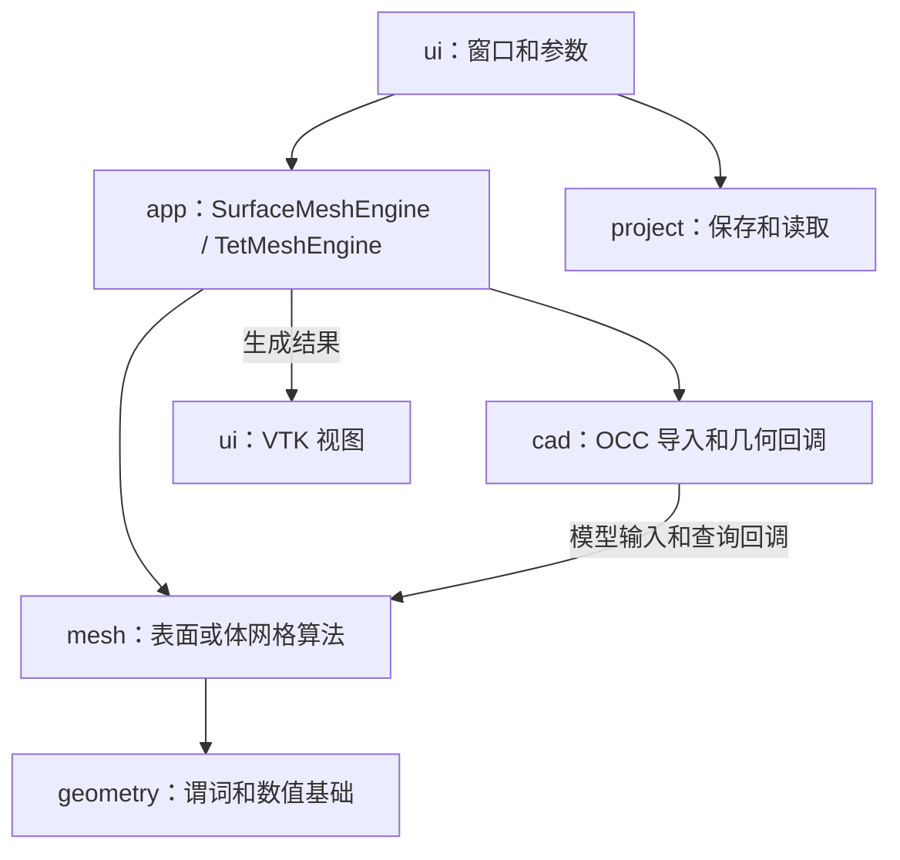

# MeshStudio 模块导航（2026-10-10）

日常方案包含两个产品工程：`MeshStudio` 是应用，`mesher` 是纯 C++17 算法库。`ALL_BUILD` 和 `ZERO_CHECK` 是 CMake 辅助工程。测试保留在 `tests/`，只有 `BUILD_TESTING=ON` 才生成。

## 从目录识别职责

| 目录 | 职责 | 建议先读 |
|---|---|---|
| `src/ui/` | 窗口、视图、对话框、面板、样式控件 | `window/MainWindow.cpp`、`viewport/ViewportWidget.cpp` |
| `src/app/` | 程序启动、参数转换、网格生成应用入口 | `main.cpp`、`meshing/SurfaceMeshEngine.cpp`、`meshing/TetMeshEngine.cpp` |
| `src/cad/` | CAD 导入、OCC 几何查询、算法回调适配、CAD 展示转换 | `import/ShapeLoader.cpp`、`occ/OccCadGeometry.cpp`、`occ/OccAlgorithm6Adapter.cpp` |
| `src/project/` | 工程数据、工程包保存和读取 | `MeshProject.h`、`ProjectArchive.cpp` |
| `src/geometry/` | 计算几何和数值基础：点/向量、方向/圆内/球内谓词、线性系统、三角函数 | `types/MesherTypes.h`、`predicates/GeomPredicates.h` |
| `src/mesh/data/` | 网格节点、连接、二维编辑事务 | `Mesh2D.h`、`TetMesh3D.h` |
| `src/mesh/planar/` | 二维 Delaunay、约束恢复、Ruppert 细化 | `Delaunay2D.h`、`Constrained2D.h` |
| `src/mesh/surface/legacy/` | 现有默认表面生成、尺寸/质量策略、局部重网格、分区 | `CadSurfaceMesher.h` |
| `src/mesh/surface/algorithm6/` | 自研 Algorithm 6 的完整表面生成链路 | `pipeline/SurfaceGenerator.h` |
| `src/mesh/volume/` | 四面体生成、约束、域提取、细化、翻边和平滑 | `Delaunay3D.h`、`Ruppert3D.h` |
| `src/mesh/validation/` | 表面及体边界的独立检查 | `SurfaceMeshValidation.h`、`VolumeBoundaryValidation.h` |
| `src/mesh/runtime/` | 取消、预算和运行观察 | `MeshingObserver.h` |

`geometry` 和 `mesh` 编入 `mesher`，不链接 Qt、VTK、OCC 或 Gmsh。`app`、`ui`、`cad`、`project` 编入 `MeshStudio`；其中 OCC 适配把真实 CAD 查询作为回调提供给算法。算法中的 CAD 身份和回调类型不等于 OCC 依赖。

## 实际调用关系



表面生成：`MainWindow` 收集参数并启动后台任务 → `SurfaceMeshEngine` 读取 CAD → 选择默认 legacy 或显式 Algorithm 6 → CAD 适配提供查询 → 算法生成 → 转为 VTK 网格 → 显示和保存。

CAD 体网格生成：先取得已有索引表面，或调用 `SurfaceMeshEngine` 生成表面，再调用 `TetMeshEngine` 的索引表面重载。STL 走已有三角片焊接入口。`ShapeTessellator` 服务 CAD 展示；它不是当前 CAD 体网格入口的替代生成器。

## Algorithm 6 按阶段查找

```text
algorithm6/
  pipeline/     主编排、周期入口、最终装配
  data/         运行合同、FaceMesh、FrontMesh、BDS、半边拓扑
  boundary/     曲线离散、共享边界登记、尺寸求值
  chart/        普通/周期 UV 图表和参数域
  geometry/     本算法使用的曲面度量、参数反求、圆/曲面求交
  initial/      初始剖分、约束恢复、域分类、UV 合法化
  bds/          BDS 转换、约束/曲线恢复、域分类和度量合法化
  front/        节点尺寸、前沿队列、候选、定位、空腔和插点
  postprocess/  转移、周期缝重建、面转换、原平滑
```

阅读顺序：`pipeline/SurfaceGenerator.cpp` → 各阶段头文件 → 需要排查的阶段实现。主链为边界 → 图表 → 初始剖分/恢复/域分类 → BDS → 前沿 → 转移/平滑 → 装配。

该目录原名 `core/mesher/gmsh_reference`，内容是自研复现代码，不调用 Gmsh。目录已重命名，现有 `mesher::gmshReference` 命名空间暂时保留以限制迁移范围；真实参考进程和对照工具仍在 `tests/`。

## 当前边界

此次整理改变文件路径、include、构建清单和 VS 分类，保持生产默认和算法行为。目录清楚不代表所有函数都足够短：`MainWindow` 仍同时管理窗口、任务和工程状态，`CadSurfaceMesher` 的表面编排仍较长；这些函数的拆分属于另一次代码重构。

打开 `build/MeshStudio.sln` 后，工程树按实际目录显示，同一模块的头文件和 cpp 放在一起。测试方案仍用 `cmake -S . -B build-tests -DBUILD_TESTING=ON` 单独生成。
