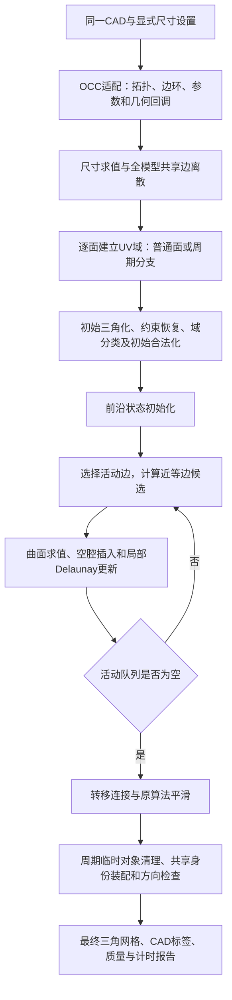

# Gmsh Algorithm 6 主生成流程：审阅方案

日期：2026-10-08；更新2026-10-09。状态：**A—D在用户确认的固定Gmsh相对对照范围内已交付验收**。当前34组相对质量通过，31个绝对审计合格配置93轮正式测量全部质量/速度通过（最慢中位比1.636623）；完整手机错误相交集合、自然BREP边界重试/取消及当前球面/手机真实窗口流程已补齐，终态逐文件独立核验通过。三个双方共有绝对失败、旧2.573首次性能失败保留，无用户几何容限不宣称绝对精度达标。详见唯一当前[最终验收报告](2026-10-09-algorithm6-final-acceptance-results.md)。以下原审阅设计与门槛保留，不恢复额外加密或共同缺陷优化。

目标：使用现有OCC几何能力及自研网格模块，实现固定Gmsh 4.15.2 Frontal-Delaunay（Algorithm 6）的独立串行一阶三角面生成入口；在相同CAD、尺寸及算法设置下，直接比较最终三角形形状质量、几何误差、拓扑和速度。先复刻该算法，再考虑自有优化。

本稿由用户此次收窄范围的要求产生。旧12项计划保留作为历史研究；本稿获批准后，以本稿决定后续实施顺序，不自动恢复全部旧任务。本次只新增方案文档，不修改算法、不构建、不启动后台任务。

## 1. 范围与取舍

采用**现有几何库 + 已有自研算法模块 + 独立生成编排**。OCC继续负责BREP、曲线/曲面求值、导数、pcurve和投影；网格尺寸、边界离散、三角剖分、前沿插点、拓扑更新和平滑由自己的模块负责。生成器不链接或调用Gmsh；Gmsh只作为独立对照程序。

本轮覆盖：各向同性、串行、一阶三角网格；普通裁剪面、孔洞、常用周期曲面及共享CAD边。尺寸先采用显式常量h；主链通过后验证已有点尺寸/曲率尺寸功能。保留真实特征、嵌入约束和部件身份。

暂不开展：并行、四面体、高阶、跨光滑CAD分割的compound/分区扩展、自有额外质量优化、Gmsh其他网格算法、整套几何内核或逐浮点数复刻。用户允许跨光滑分割边的决定保留为后续扩展，本次两侧对照使用同一CAD分面。

Gmsh在算法6失败时可能切到MeshAdapt。此次算法6对照显式关闭自动切换，记录失败面和原因，不将另一个算法的结果当作算法6效果。若真实模型必须引入另一算法才能完成，先报告并交用户决定，不能扩展旧计划自行实现MeshAdapt。

底层改动的触发条件：**独立入口已有具体失败模型或明确质量差异，且调用证据指向几何/数值底层**。已有SVD/参数反求代码保留；不因代码已写或某分支尚未覆盖而继续扩展它。每次底层修正都要说明受影响的案例，回到最终网格复验。

取舍：继续逐步骤全量复刻会扩大工作；直接使用Gmsh生成违背自研算法目标；本方案优先把Algorithm 6主链接成可交付结果。

## 2. 完整主流程

步骤说明：

1. **几何输入**：直接读取BREP，独立取得CAD实体、边环、端点、曲线参数和曲面参数。各面引用同一条共享CAD边的离散结果；不读Gmsh导出的拓扑序、UV、网格或运行状态作为生成输入。
2. **尺寸与边界**：采用相同h和尺寸选项，生成共享曲线节点及有向线段链。边界尺度决定前沿入口，不把旧产品的质量细化参数偷偷映射进来。
3. **面内初始网格**：普通面和周期面使用原算法对应的分支。恢复边界/孔洞/嵌入约束、识别有效域，再完成原初始合法化。保持参数域与物理身份分开。
4. **前沿初始化和循环**：复用原尺寸、度量、活动队列、候选放置、空腔和插点模块。成功插点立即反馈同一队列；不追加全图反复优化或事后点阵重排。
5. **原算法后处理**：转移连接，按原设置平滑。周期副本的物理身份映射、原存储参数和运行UV分别保存，临时对象在其最后使用之后清理。
6. **模型装配**：使用共享身份连接各面，输出面/部件/边标签、每角UV和统一节点表。不同部件接触点不因坐标相同而擅自合并。
7. **结果验证**：保存可直接显示的网格，独立测量形状、CAD误差、拓扑和耗时。失败、取消、预算耗尽均显式报告，不作为完整成功结果。

## 3. 模块职责和命名

按职责组织，不为了这张表重新拆分已有细分文件。

| 职责组 | 使用/计划接口 | 责任边界 |
| --- | --- | --- |
| OCC几何适配 | 现有OccCadGeometry、OccMeshVertexParameters；计划OccAlgorithm6Adapter的buildModelInput/buildFaceInput | 把CAD与自己的数据结构接起来，只供拓扑和几何，不生成三角网格 |
| 尺寸与共享边 | MeshSizeEvaluator、BoundaryRegistry；buildBoundaryMesh | 每CAD边一份物理离散，保留端点和参数身份，不管理面前沿 |
| 面域与初始网格 | FaceChart/PeriodicFaceChart、InitialTriangulation及已有恢复/分类/合法化模块 | 输出合法的初始约束三角网格，不执行前沿生成或平滑 |
| 前沿生成 | initializeNodeSizes、initializeFrontTriangles、generateFrontMesh及已有候选/空腔/插点模块 | 根据尺寸与度量布点、更新局部拓扑和队列，不装配全模型 |
| 转移与平滑 | transferFrontMesh、smoothSurfaceMesh | 输出连接并执行原算法平滑，不加自有质量改造 |
| 结果装配 | 计划MeshAssembly::assembleSurfaceMesh | 清理有明确所有权的临时副本、统一共享身份与标签，不按坐标随意合点 |
| 顶层编排 | 计划SurfaceGenerator::generateFaceMesh/generateSurfaceMesh | 只串联上述流程、传递状态和进度，不把全部算法塞入一个函数 |

函数名为动作+对象。现有接口沿用；新增名在实施前核对重复与签名。生成结果与质量审计结果分开：生成成功不能自动代表质量验收通过。

## 4. 当前已有工作与真实缺口

源码中已有尺寸/边界、普通和周期初始剖分、恢复/分类、前沿、连接转移、参数源和平滑模块。已有测试驱动能串联部分流程。它们作为现成实现复用，不能据此宣称从CAD到最终模型已完成。

主要缺口：

- 缺独立顶层入口；当前SurfaceMeshEngine仍调用既有generateCadSurfaceMesh/分区路线。
- 测试驱动的部分1D、拓扑和较早UV输入来自参考，尚需由自己的CAD适配与边界模块提供。
- 缺面间共享身份的最终装配、周期临时对象清理和完整结果输出。
- 缺同模型、同参数的最终质量/外观/速度验收；阶段逐值通过不能替代这些证据。

**因此下一步先补输入、编排与输出，不继续优先增加几何底层模块。** 测试驱动中的编排迁入正式模块时保留原行为，避免另写一套生成算法。

## 5. 实施顺序与每阶段交付

### 阶段A：一个普通面，从CAD独立生成到网格

计划新增：`src/core/OccAlgorithm6Adapter.h/.cpp`、`src/core/mesher/gmsh_reference/SurfaceGenerator.h/.cpp`、`MeshAssembly.h/.cpp`；新增`tests/GmshSurfacePipelineTest.cpp`及`tests/GmshSurfaceReproductionBenchmark.cpp`，局部更新CMake。先只实现普通面所需部分，不预建无用途的接口或大框架。

- [x] 定义CAD输入到最终网格的接口，并列出仍来自参考的输入，逐项由现有自研/OCC能力替换。
- [x] 首先接通矩形：共享边离散→面域/初始网格→前沿→转移/平滑→最终装配。
- [x] 验证带孔平面和窄带，保存边界、初始网格、平滑前网格和最终网格。
- [x] 用独立Gmsh进程生成同参数参考，输出两份VTP网格和同口径质量报告；执行关闭参考输入的独立生成检查。

交付：用户能看到**自己的生成结果与Gmsh结果**，并确认主布局是否正确；可运行入口仅依赖CAD、尺寸和运行配置。平面入口不成立，就在这条主链定位首个差异，暂停扩展曲面。

### 阶段B：曲面、周期缝和孔洞

- [x] 对接圆柱、球面、非线性B样条及凹曲面；复用已有周期分支，补必要CAD输入适配。
- [x] 补周期临时对象清理与每角UV保存；检查物理共享节点一致，缝附近连接与方向正确。
- [x] 验证裁剪孔洞、极点及已有嵌入约束，记录失败面和触发条件。
- [x] 比较局部点阵、角度分布、尺寸分布和CAD偏差。出现差异时只处理对应调用链。

交付：一组普通/周期曲面最终网格及同参数对照。缺必要分支明确补齐，不能为了“先跑起来”删掉缝/孔洞/真实约束。

### 阶段C：多面与真实模型

- [x] 把独立generateSurfaceMesh接入多面共享边与部件标签装配。
- [x] 对同一凹球和phone BREP运行两侧基准，记录每面状态及实际算法；失败面不从报告中消失。
- [x] 验证已有点尺寸/曲率尺寸与常量尺寸两类输入，采用相同配置对照。
- [x] 保存全模型与局部放大图、质量着色和残差位置，判断质量差异来自边界约束、尺寸场还是前沿决策。

交付：整模型结果与主要差异说明。若参考自动切换到其他算法，单独记录，先不扩大本次实现范围。

### 阶段D：速度与实验入口验收

- [x] 对已经质量通过的案例关闭详细轨迹，进行三轮串行计时；CAD读取、生成、审计、导出分开计时，两侧范围一致。
- [x] 只处理证据明确的热点，保持原生成规则；不通过减少精度或换布局获取速度。
- [x] 接入独立实验选择入口，复用现有显示/导出结构；生产默认保留。确实修改GUI时才运行真实窗口生成、取消和保存重开检查。

交付：可选择、可显示、可导出的实验生成器及最终质量/性能报告。用户再次审阅后才决定默认路线或额外优化。

## 6. 对照设置与拟定验收标准

固定Gmsh 4.15.2、`Mesh.Algorithm=6`、一阶、串行、`Mesh.AlgorithmSwitchOnFailure=0`。第一组用显式常量h，关闭点尺寸/曲率尺寸影响；两侧一致设置边界尺寸传播、平滑轮数和扰动选项。后续变化尺寸逐项开启。记录有效设置、模型文件hash、程序版本和失败面。

每阶段至少检查：

| 项目 | 本稿拟定验收标准 |
| --- | --- |
| 独立性 | 自研生成输入为CAD+配置，核心无Gmsh链接/隐式调用，不消费参考网格或中间状态 |
| 主流程 | 边界/初始/前沿/平滑阶段顺序与算法6一致；逐值对照用于定位首个差异，不把全库零容差作为发布前提 |
| 拓扑 | 无新增零面积片、重复片、孔洞填错、越出裁剪域的片或共享边裂缝；面向/标签一致。不同部件的合法接触与同部件错误分别判定 |
| 形状 | 复用独立三维测量：近等边定义各角位于50°–70°；报告全域/边界/内部的近等边比例、最小角P1/P5和低角比例。拟定近等边比例不低于参考5个百分点、最小角P5不低于参考2°、最小角<25°比例不高于参考1个百分点；样本范围与判据在首轮参考后锁定，失败不得自动放宽 |
| 几何 | 两侧相同h、同CAD采样合同；独立测量面片到CAD及CAD到面片的距离，保存最大值和分位数。用户已有偏差容限优先；无容限时先给参考对比及实际差值，不凭空宣称“高精度” |
| 外观 | 同区域、同视角显示整体与放大网格，确认没有明显成片细长三角或异常密度带；数值与视图共同审阅 |
| 速度 | 关闭轨迹后的三轮生成中位耗时及热点；拟定生成耗时不超过同配置Gmsh的2倍，超过则明确保留为未达标，不承诺未经测量的速度 |

上述质量和速度数字是**本次审阅的建议门槛**，不是已实现或已测结果。平均值不能掩盖某个面/狭窄区域的明显劣化；残差集中出现时必须列出位置和原因。受CAD边界约束的三角形也不能从总指标中删掉。

## 7. 何时停下来交用户决定

- 需要切换另一网格算法、改变CAD拓扑/特征、加入跨面分区或自有质量优化。
- 必须修改新的底层算法，且其范围明显超出当前失败案例。
- 拟定验收指标需要调整，或某个真实模型需要正式排除。
- 需要修改默认生成路线、创建分支/worktree、删除已有实现、提交/推送。

阶段A产出后先展示结果再进入后续扩展。阶段汇报只包含：看到的网格效果、质量/耗时、剩余具体差异和下一步；不再用大量模块测试次数代替生成结果。

## 8. 审阅后首先执行什么

**先实现普通面的独立CAD→最终网格入口，并交付矩形、带孔、窄带的两侧结果。** 复用已有代码，只补必要输入适配、编排和装配。确认这一步符合目标后，再推进周期曲面和真实模型。

阶段A已交付三例六组结果，B—D及剩余验收已获后续授权并完成。清单按当前相对验收证据勾选；明确范围、版本、性能资格及共有失败以页首最终报告为准，不等于任意CAD绝对质量通过。
